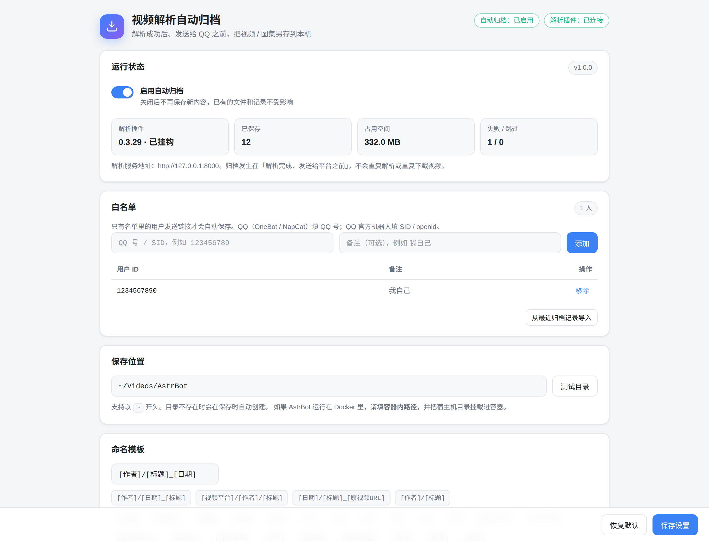

# 视频解析自动归档

> 配合 [ParseVideo 视频图集解析](https://github.com/baige778/astrbot_plugin_api_video_parser) 使用：
> 白名单用户发送视频/图集链接后，在机器人把媒体发出去之前，自动把同一份文件存到本机。

<p align="left">
  
</p>



## 它解决什么问题

ParseVideo 解析插件会把视频下载到临时目录再发给 QQ，临时文件过一会儿就被删掉。
本插件在「解析完成、还没发给平台」的阶段把文件复制到你指定的目录，并按模板命名：

```
白名单用户发链接
      │
      ▼
ParseVideo 解析插件 ──► parse-video-py（解析 / 下载到临时目录）
      │
      ▼
本插件 on_decorating_result（结果已生成、发送前）
      │  复用解析插件刚拿到的标题 / 作者 / 图集信息
      │  复制本地视频文件，或解码图集图片
      ▼
保存到「保存目录 / 模板路径」
      │
      ▼
AstrBot 继续把视频/图集发给 QQ
```

* **不重复调用解析接口、不二次下载视频**，保存的就是机器人真正要发出去的那份文件。
* 保存失败不会影响机器人正常发送，失败原因会记录在插件页面。
* 解析插件升级后若内部方法改名，会自动退化为从「标题：/作者：」消息文本提取元数据。

## 功能

- 🔐 **白名单**：只有名单里的 QQ 号 / SID 发的链接才会保存，支持备注。
- 📁 **自定义保存目录**：任意绝对路径，支持 `~`；一键测试目录可写和剩余空间。
- 🧩 **命名模板**：`/` 分目录，实时预览，20+ 占位符，图集自动编号。
- 🎞️ **视频 / 图集**：视频直接复制本地文件，图集逐张保存（含实况图）。
- 🧾 **归档记录**：时间、发送者、平台、标题、文件、状态一目了然。
- ⚙️ **高级选项**：同名覆盖、同一链接只存一次、文件名长度、历史条数。

## 安装

### 方式一：AstrBot 插件市场（发布后可用）

在 WebUI「插件」页搜索 **视频解析自动归档** 安装。

### 方式二：仓库地址安装

AstrBot WebUI → 插件 → 安装插件 → 填本仓库地址：

```text
https://github.com/your-name/astrbot_plugin_video_archiver
```

### 方式三：手动

```bash
cd AstrBot/data/plugins
git clone https://github.com/your-name/astrbot_plugin_video_archiver.git
```

然后在 WebUI 插件页重载本插件。首次打开时插件会自己创建配置文件和默认目录。

> 依赖：[astrbot_plugin_api_video_parser](https://github.com/baige778/astrbot_plugin_api_video_parser)
> 与一个可用的 parse-video-py 服务。

## 使用

1. 打开 WebUI 左侧「归档设置」。
2. 在**白名单**里加上你的 QQ 号（QQ 官方机器人填 SID / openid）。
3. 设置**保存目录**，点「测试目录」确认可写。
4. 设置**命名模板**，看下方效果预览。
5. 保存设置，然后给机器人发一条视频分享链接。

默认目录为 `~/Videos/AstrBot`，默认模板为 `[作者]/[标题]_[日期]`。

## 占位符

| 占位符 | 含义 |
| --- | --- |
| `[作者]` | 作者 / UP 主昵称 |
| `[作者ID]` | 作者 ID（解析结果提供时） |
| `[标题]` | 视频 / 图集标题 |
| `[日期]` | 保存日期，如 `2026-11-11` |
| `[时间]` | 保存时间，如 `22-21-33` |
| `[年]` `[月]` `[日]` `[时]` `[分]` `[秒]` | 单独的时间片段 |
| `[视频平台]` | 平台中文名（抖音、B站、搜狐视频……），识别不出来时为空 |
| `[平台代码]` | 平台英文代码，如 `douyin` |
| `[原视频URL]` | 原始分享链接（清洗成可读文件名，并带短哈希防重） |
| `[视频ID]` | 从链接里提取的作品 ID |
| `[视频类型]` | `视频` / `图集` |
| `[序号]` | 图集序号 `01`、`02`…… |
| `[发送者]` / `[发送者QQ]` | 发送者昵称 / QQ 号或 SID |
| `[群号]` | 群号（私聊为空） |
| `[随机]` | 6 位随机串 |
| `[后缀]` | 文件后缀（不带点）；写了它就不再自动追加后缀 |

示例：

```text
[作者]/[标题]_[日期]
=> ~/Videos/AstrBot/小小鱼/今天的晚霞真好看_2026-11-11.mp4

[视频平台]/[作者]/[日期]_[标题]
=> ~/Videos/AstrBot/抖音/小小鱼/2026-11-11_今天的晚霞真好看.mp4

[作者]/[标题]_[原视频URL]
=> ~/Videos/AstrBot/小小鱼/今天的晚霞真好看_v.douyin.com_iRNBZ4k_ab12cd.mp4
```

* 图集多张时，如果模板里没写 `[序号]`，会自动追加 `_01`、`_02`。
* 文件名非法字符会替换成 `_`，同名文件默认自动加 `_2`、`_3`。
* 平台识别不出来时 `[视频平台]` 为空，不影响其它占位符。

## 配置与数据

| 内容 | 路径 |
| --- | --- |
| 配置文件 | `AstrBot/data/plugin_data/astrbot_plugin_video_archiver/settings.json` |
| 归档记录 | `AstrBot/data/plugin_data/astrbot_plugin_video_archiver/history.json` |
| 默认保存目录 | `~/Videos/AstrBot` |

> 如果 AstrBot 跑在 Docker 中，`~` 和路径都是**容器内路径**。请把宿主机目录挂载进容器，
> 并在管理页填写容器内的挂载点（例如 `/AstrBot/data/media`）。

## 常见问题

**为什么没有保存？**

- 发送者不在白名单；
- 解析插件没有解析成功，或视频超过解析插件的大小上限被跳过（没有发出媒体就不会归档）；
- 目标目录不可写，去「最近归档」看失败原因。

**QQ 官方机器人填什么 ID？**

填 SID / openid（`event.get_sender_id()` 的值），不是 QQ 号。

**会重复下载视频吗？**

不会。视频直接复制解析插件已经下载到 `data/temp/video_parser` 的本地文件；图集直接解码
消息里的 base64，不额外请求 CDN。

**支持哪些平台？**

取决于解析插件和 parse-video-py 后端，常见平台都支持；`[视频平台]` 识别不出来时为空。

## 目录结构

```text
astrbot_plugin_video_archiver/
├── metadata.yaml
├── main.py
├── logo.png
├── views/settings/        # 插件可视化设置页
├── .astrbot-plugin/i18n/  # 中英文文案
└── docs/screenshot.png
```

## 发布到插件市场

1. 把 `metadata.yaml` 里的 `repo` 改成你的仓库地址，确认仓库是公开的。
2. 到 <https://cloud.astrbot.app/publish> 提交仓库。
3. 插件压缩包需小于 16MB（本插件约 100KB）。

## 致谢

- [ParseVideo 视频图集解析](https://github.com/baige778/astrbot_plugin_api_video_parser)（作者 baige778，
  README 中声明 MIT）：本插件与它配合工作，但为独立实现，未复制其源代码，它作为可选运行时依赖单独安装。
- [AstrBot](https://github.com/AstrBotDevs/AstrBot) 插件开发文档与 WebUI 组件规范。

## 许可

[MIT](LICENSE)
